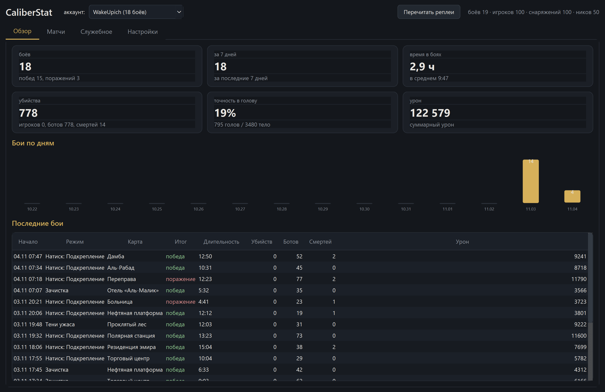
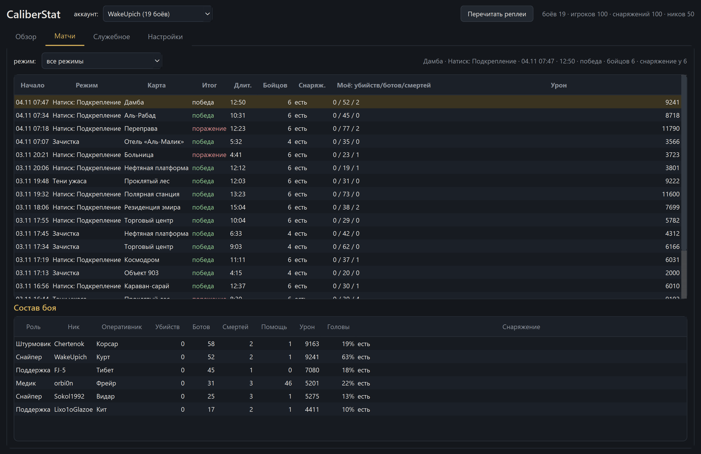
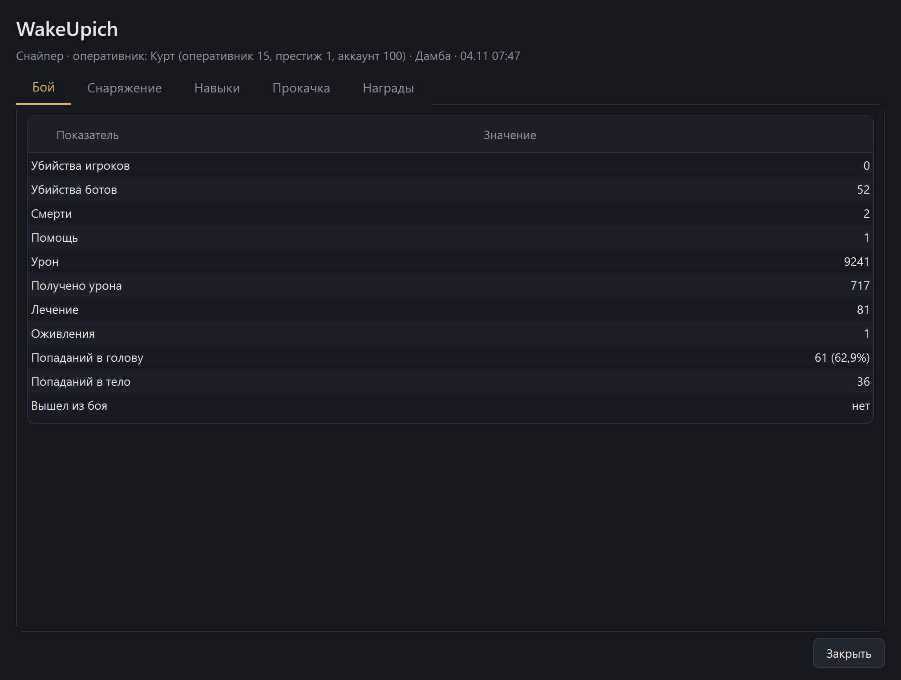

# CaliberStat

Статистика «Калибра» из лога игры и реплеев: обзор, матчи, состав боя, подробная
карточка игрока с деревом навыков и прокачкой. Портативно: папку скопировал —
работает, база и настройки живут внутри папки.

План работ и границы проекта — [docs/PLAN.md](docs/PLAN.md).

## Как запускать

**Портативная сборка (без Python):** `CaliberStat.exe` из папки `dist\CaliberStat`.
Копируй папку целиком куда угодно — рядом с exe появятся `data\`, `logs\`, `ref\`.

**Из исходников:**

```powershell
python -m venv .venv
.\.venv\Scripts\python.exe -m pip install pyside6

.\.venv\Scripts\python.exe app.py --window   # трей + окно (как в бою)
.\.venv\Scripts\python.exe gui.py            # только окно
```

## Что делает

- **Сбор лога** — читает `Player.log`, переживает перезапуск игры и себя.
- **Реплеи** — кнопка «Перечитать реплеи» и автоподхват: после боя бой сам
  появляется в статистике, чужие реплеи можно залить файлом или папкой.
- **Окно** — обзор (карточки, график по дням), матчи с фильтром, состав боя,
  карточка игрока по вкладкам (бой, снаряжение, навыки, прокачка, награды):
  телеметрия с попаданиями в голову и тело, снаряжение с модулями и скинами,
  выбранные в бой навыки с уровнями, прокачка оперативника по уровням.
- **Трей** — статус, старт/стоп сбора, автозапуск при входе в Windows,
  сторож (`watchdog.py`) поднимает трей после падения.
- **Справочники из клиента** — кнопка с прогрессом: карты, оперативники, оружие,
  модули, навыки, скины, казни, медали. После патча игры — нажать снова.

## Файлы

| Файл | Что делает |
|---|---|
| `app.py` | трей, сбор в фоне, подхват реплеев (главный вход) |
| `gui.py` | окно: обзор, матчи, состав боя, карточка игрока, служебное, настройки |
| `queries.py` | запросы к базе для окна |
| `collector.py` | чтение `Player.log` |
| `caliber_db.py` | схема базы и запись |
| `replay.py` / `replays.py` | разбор одного реплея и пакетный обход папок |
| `client_data.py` | справочники и деревья из файлов клиента |
| `refs.py` | подстановка названий в интерфейс |
| `paths.py` / `detect.py` | папки программы, настройки, автоопределение путей |
| `watchdog.py` | сторож трея |
| `CaliberStat.spec`, `build.cmd` | сборка портативного exe |

## Как выглядит





## Сборка

```powershell
.\.venv\Scripts\python.exe -m pip install pyinstaller
build.cmd
```

Результат — `dist\CaliberStat\` (папка целиком, ~110 МБ). Внутри `CaliberStat.exe`;
база, журналы и справочники создаются рядом с ним, а не в профиле пользователя.

## Проверки

```powershell
python queries.py            # цифры обзора без окна
python replays.py --scan     # разбор реплеев с прогрессом
python client_data.py        # справочники из клиента
python detect.py --show      # что нашлось на этой машине
python gui.py --shot docs\preview-overview.png   # снимок окна
```
